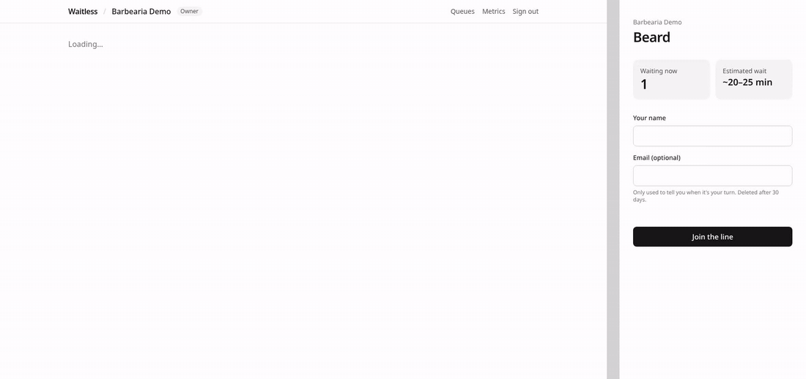
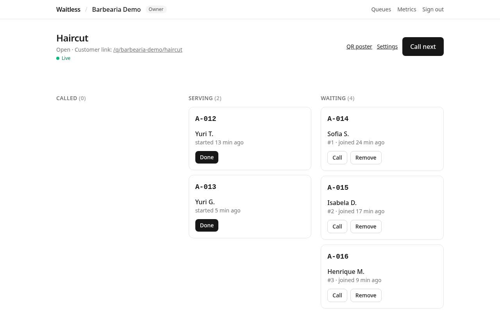
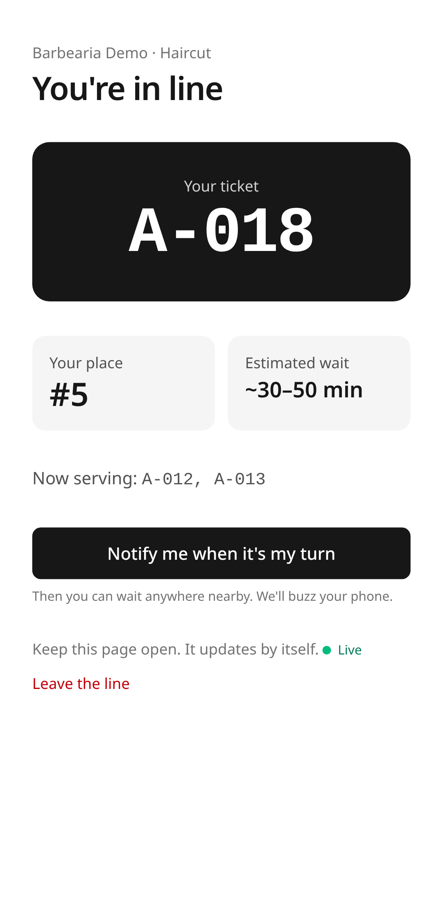
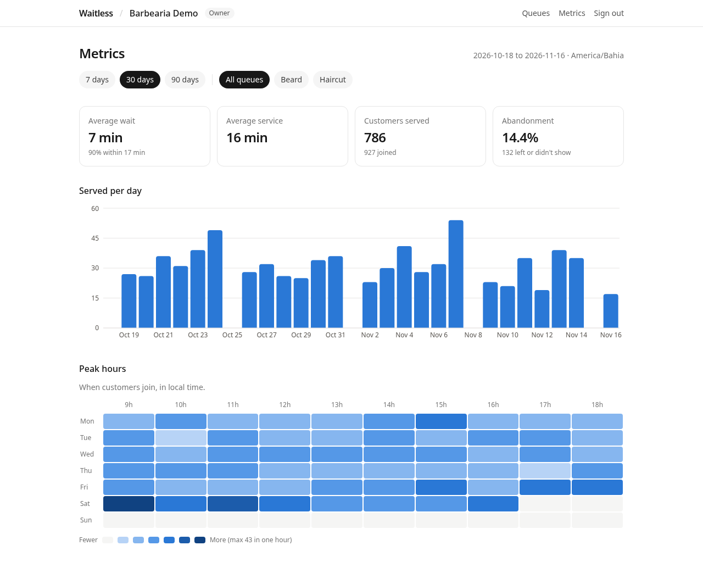
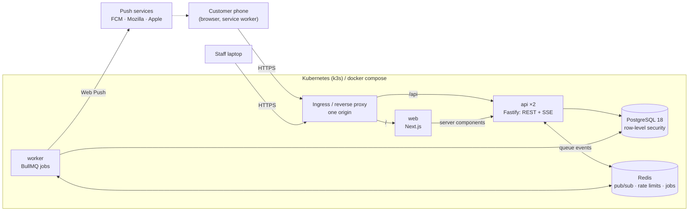

# Waitless

**A virtual queue for small businesses.** Customers scan a QR code at the counter, join the line from their phone, watch their place update live, and get a push notification when it's their turn.

**Live demo:** not hosted yet; the deployment is ready (see [Deployment](#deployment)), and it [runs locally](#run-locally) in three commands · **Demo login:** `owner@demo.waitless.dev` / `demo1234`



## Why

In Brazil, most barbershops, clinics and pet shops still run walk-in queues on paper or in a WhatsApp thread. Customers can't tell how long they'll wait, so many give up and leave. Owners write names on a notepad and have no idea when they're busiest.

With Waitless, customers wait at the café next door instead of in the shop, and the owner gets a live board plus numbers on peak hours, wait times and lost customers.

## Features

- **Join from a QR code.** No app and no account: a name (and optionally an email) is enough. The ticket page shows the ticket number (`A-023`), the customer's place in line and a wait estimate, and updates live.
- **Push notifications** when you're almost up and when it's your turn (Web Push; on iPhone, after "Add to Home Screen").
- **Live queue board** for staff: call next, start, done, push back, no-show, remove, add a walk-in. Several staff can click at once safely.
- **Metrics** in the shop's timezone: average and p90 wait, service time, abandonment rate, customers served per day, and a weekday × hour heatmap.
- **Printable A4 QR poster** for each queue.
- **Multi-tenant:** one deployment serves many businesses, isolated by the database itself.

| Queue board | Customer's phone | Metrics |
|---|---|---|
|  |  |  |

## Architecture



The browser only talks to one origin: the ingress sends `/api` to the API and everything else to Next.js, so there's no CORS and the session cookie stays first-party. The API is stateless and runs as two or more replicas. A change made on one replica (say, "call next") is announced on a Redis channel for that queue, and every replica with a customer watching that queue reloads its state once and pushes it to its own Server-Sent Events streams. A separate worker sends push notifications and runs delayed jobs such as auto no-show. Every query on tenant data runs inside a transaction that sets the tenant, and Postgres row-level security filters every row.

## Engineering highlights

- **Two staff click "Call next" at the same moment.** One `UPDATE` takes its target from `SELECT … FOR UPDATE SKIP LOCKED`: each transaction locks a different customer, nobody blocks, nobody is called twice. Proven by 20 parallel calls against 10 waiting customers: 10 called, 10 empty, 0 errors. [ADR-0003](docs/adr/0003-concurrency-safe-call-next.md) · [`callNext`](packages/db/src/queue.ts) · [test](packages/db/src/queue.test.ts)
- **Tenants can't see each other's data, even through a buggy query.** Shared tables with Postgres row-level security, *forced* on the table owner too, and fail-closed: no tenant set means zero rows. The app connects as a role that can't bypass RLS, and composite foreign keys stop cross-tenant references. [ADR-0001](docs/adr/0001-multi-tenancy-with-postgres-rls.md) · [policies](packages/db/migrations/0002_rls.sql) · [isolation test](packages/db/src/rls.test.ts)
- **Real-time across replicas.** Server-Sent Events over plain HTTP, and Redis pub/sub between replicas: one subscription per queue per replica, one database query per event per replica (not per client), full snapshots so a dropped message never corrupts state. Tested with two API instances in one test, and verified behind Caddy and Kubernetes. [ADR-0002](docs/adr/0002-sse-over-websockets.md) · [ADR-0004](docs/adr/0004-redis-pubsub-fan-out.md) · [code](apps/api/src/realtime) · [fan-out test](apps/api/src/realtime/realtime.test.ts)
- **Honest wait estimates.** An exponentially weighted average of today's service times, divided across active chairs, shown as a rounded range ("~15–20 min") instead of false precision, with a fallback before there's any data. Pure functions, unit-tested. [`eta.ts`](packages/shared/src/queue/eta.ts) · [tests](packages/shared/src/queue/eta.test.ts)
- **Jobs that are safe to repeat.** Notifications are deduplicated twice (BullMQ job ids and a unique index on what was sent), retried with backoff, and dropped for dead subscriptions. The delayed auto no-show carries the time of the call it belongs to, so a stale job after a push-back and re-call does nothing. [ADR-0005](docs/adr/0005-web-push-over-whatsapp-sms.md) · [processors](apps/api/src/jobs/processors.ts) · [tests](apps/api/src/jobs/jobs.test.ts)
- **Deploys that never run new code on an old schema.** Kubernetes applies infrastructure, then a role bootstrap Job, then migrations, and only then the app, waiting at each step. [ADR-0008](docs/adr/0008-k3s-on-one-vps-with-kustomize.md) · [`deploy.sh`](deploy/k8s/deploy.sh)

All decisions: [ADR-0001](docs/adr/0001-multi-tenancy-with-postgres-rls.md) row-level security · [ADR-0002](docs/adr/0002-sse-over-websockets.md) SSE · [ADR-0003](docs/adr/0003-concurrency-safe-call-next.md) SKIP LOCKED · [ADR-0004](docs/adr/0004-redis-pubsub-fan-out.md) Redis fan-out · [ADR-0005](docs/adr/0005-web-push-over-whatsapp-sms.md) Web Push · [ADR-0006](docs/adr/0006-session-cookies-over-jwt.md) session cookies · [ADR-0007](docs/adr/0007-same-origin-routing.md) same origin · [ADR-0008](docs/adr/0008-k3s-on-one-vps-with-kustomize.md) k3s + Kustomize. Full spec: [docs/SPEC.md](docs/SPEC.md).

## Run locally

Needs Node.js 24, pnpm 12 and Docker.

```bash
cp .env.example .env && docker compose up -d     # Postgres, Redis, Mailpit
pnpm install && pnpm db:migrate && pnpm db:seed  # schema + two demo businesses with 30 days of history
pnpm dev                                         # web :3000, API :3001, worker
```

Open http://localhost:3000 and sign in with `owner@demo.waitless.dev` / `demo1234`. For push notifications, run `pnpm vapid:generate` and put the keys in `.env`.

To run it like production instead (Caddy, two API replicas, worker, built images) on http://localhost:8080: `docker compose --profile full up -d --build`.

## Tests

```bash
pnpm test        # unit + integration (Testcontainers starts real Postgres 18 and Redis 8)
pnpm test:e2e    # Playwright, against `docker compose --profile full`
```

- **Unit:** the queue rules are pure functions: every state transition, ETA math, push-back ordering, display codes, what the public view hides, notification rules, metrics helpers.
- **Integration** (real Postgres and Redis, the app's own non-owner role): concurrent call-next, tenant isolation, 50 parallel joins numbered 1..50 with daily rollover in the shop's timezone, fan-out across two API instances, stale auto no-show jobs, metrics SQL against fixed fixtures (including DST), auth, rate limits and the HTTP API.
- **End-to-end:** a phone and a laptop in two browser contexts; the phone sees "It's your turn!" without reloading.
- **Lighthouse (mobile)** on the customer pages: the join page scores 98 / 100 / 100 / 100 (performance / accessibility / best practices / SEO) and the ticket page 97 / 100 / 100 / 60. That SEO score is on purpose: the ticket page is `noindex`, because its URL is the customer's private link.

CI (GitHub Actions) runs lint, typecheck, all tests, the build, the e2e suite and Kubernetes manifest validation on every push.

## Deployment

Docker images (multi-stage, non-root) are pushed to GHCR on every green build of `main`. The Kubernetes manifests (Kustomize) run every pod as non-root on a read-only filesystem: the API with two replicas, a disruption budget and health probes; the worker; the web app; Traefik ingress with Let's Encrypt; and a nightly CronJob that resets the demo. A staged deploy script runs the role bootstrap and migration Jobs before the new version rolls out. Prometheus metrics (open SSE streams, tickets created, call-next latency, jobs processed) are served on an internal port that the ingress never exposes.

Local cluster (k3d), production setup and operations: [deploy/k8s/README.md](deploy/k8s/README.md).

## Privacy

Customers give a name and, optionally, an email. Push subscriptions are deleted as soon as a ticket ends, and emails 30 days later (a daily job). No phone numbers are collected. Logs never include tokens or contact details. This follows the data-minimization principles of Brazil's LGPD and the GDPR.

## Future work and non-goals

- **WhatsApp or SMS notifications.** Not in the MVP. The official WhatsApp Business API needs a verified business account and paid, pre-approved message templates, and unofficial gateways break WhatsApp's terms. Web Push is free and needs no phone number. A per-shop WhatsApp channel would plug into the existing `Notifier` interface.
- **Next:** team invites by email, email notifications, a Portuguese translation, a sound alert on the board when someone joins.
- **Not planned:** appointment booking with time slots, payments, native mobile apps.
- **At 10,000 shops:** partition `ticket_events` by month, a read replica for metrics, managed Postgres and Redis with replication, and sharding Redis channels by queue.

## License

[MIT](LICENSE)
